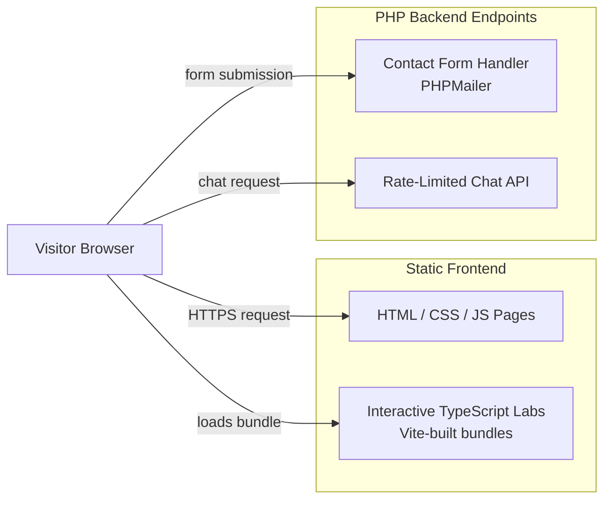
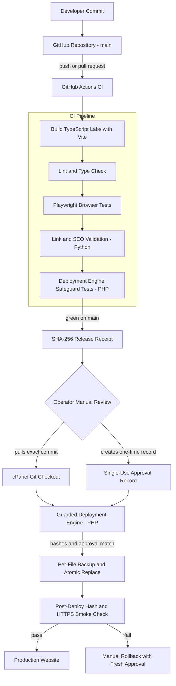

# Architecture

This page documents how the site actually runs, and separately, how a change gets from a commit to the live site. These are two different diagrams on purpose — runtime architecture and the build/test/deployment workflow are different concerns, and conflating them is a common source of confusion when reviewing a system like this.

For the full engineering narrative, see the [README](../README.md).

## Runtime Architecture

What handles a visitor's request once the site is live.

**What this shows:** the frontend is static HTML/CSS/JS plus independently built TypeScript bundles for the interactive labs — there's no server-side rendering or application framework in the request path. The only server-side logic lives in two narrow, single-purpose PHP endpoints. Nothing here runs or triggers a deployment; this diagram is the site as a visitor experiences it.

## Build, Test, and Deployment Workflow

How a change moves from a commit to the live site. This is deliberately separate from the runtime diagram above — it only runs when a developer pushes code or an operator manually deploys, never as part of serving a visitor request.

**What this shows:** CI runs automatically on every push and pull request, but it only tests and, on a clean `main` push, produces a content receipt — it never deploys anything. Reaching the live site after that requires a person to manually pull the exact commit, manually create a single-use approval record, and manually trigger the deployment engine. There is no webhook, cron job, or CI step that deploys automatically.

## Key Engineering Decisions

- **Runtime and deployment are fully separate systems.** The static site and PHP endpoints have no awareness of the deployment engine, and the deployment engine has no awareness of application logic. Neither can accidentally trigger the other.
- **CI builds and tests; it never deploys.** A green pipeline produces evidence (test results, a content receipt) for a human to act on, not an automatic action.
- **Every deployment requires two independent, non-reusable inputs:** a receipt matching the exact commit, and a single-use approval record created fresh for that release. Either missing or mismatched stops the process before any file is touched.
- **The deployment engine only ever touches an explicit, reviewed file list** — no wildcard copies, no automatic cleanup of files it doesn't recognize.
- **Rollback uses the same gated path as deployment**, not a separate, less-reviewed shortcut — a rollback needs its own fresh approval record.

---

*This document describes architecture and workflow only. It intentionally omits server paths, credentials, and other operational details that belong in the private repository, not a public one.*
